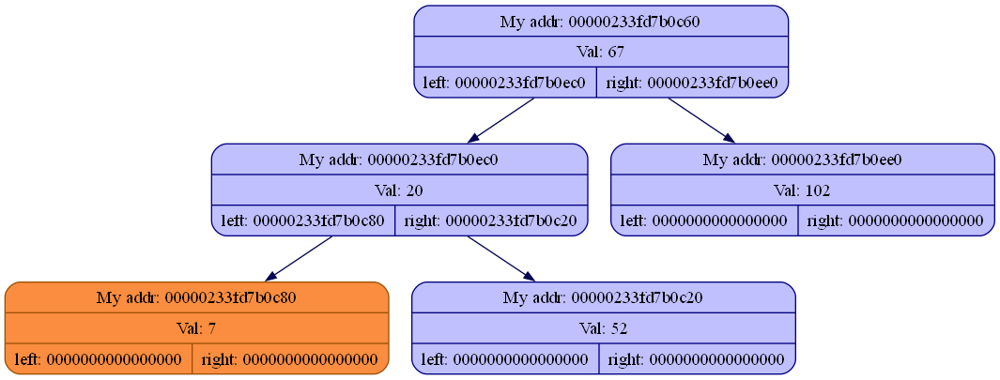

# Бинарное дерево. Сортирующее дерево. Акинатор
Этот проект является четвёртым заданием курса по программированию преподаваемого Ильёй Рудольфовичем Дединским(@ded32_ru) на первом курсе МФТИ ФРКТ.
Задание представляет из себя реализацию бинарных деревьев. В качестве примера их использования реализованы две задачи: бинарное сортирующее дерево и Акинатор

## Бинарное дерево
Классическая реализация несбалансированного бинарного дерева на C.
```C
struct binTreeNode_t {
   binTreeNodeVal_t val; // значение, хранимое в узле. Задаётся typedef 
   binTreeNode_t   *left; // указатель на левого сына
   binTreeNode_t   *right; // указатель на правого сына
};

struct binTree_t {
    binTreeNode_t *data; // указатель на корень

    ON_DBG( // информация доступная при отладке
        debuggingInfo_t debuggingData; // Отладочная информация

        binTreeNode_t *ptrToLastUsedNode; // указатель на последний созданный узел
    )
};
```

Для дерева реализованы функции:
`TreeCtor` - конструктор дерева
`TreeNodeCreate` - создание узла и прикрепление его к переданному указателю
`TreeNodeDelete` - удаление узла дерева. Удаляет и всех детей этого узла
`TreePrintPreorder` - вывод дерева префиксным обходом
`TreePrintInorder` - вывод дерева инфиксным обходом
`TreePrintPostorder` - вывод дерева постфиксным обходом


Так же для отладки реализован 
`TreeDump` выводящий дерево в log и в виде файла graphviz. 

### Отладка
Во время отладки можно (и нужно) использовать:
`TREE_CTOR` - конструктор дерева вместе с отладочной инфой
`TREE_NODE_CREATE` - создание узла с учётом запоминания информации об узле и выводом дерева
`TREE_NODE_DELETE` - удаление узлов с выводом информации

Так же при отладке создаются отладочные директории в которых лежит лог файл и результаты работы дампов.

Каждая функция логирует информацию о себе(начало работы, конец работы) с тегом INFO

## Бинарное сортирующее дерево
Очень простая надстройка над деревьями. Логика работы: при вызове функции добавления в сортирующее дерево сначала находится нужный узел а затем уже добавляется новые

Если значение узла больше переданного идём влево, иначе вправо. Если указатель на который перешли нулевой, прикрепляем новый узел

При выводе такого дерева инфиксным способом мы получим отсортированный по возрастанию набор чисел

## Акинатор
Основная часть задачи. Угадывает слово, загаданное пользователем опираясь на бинарное дерево баззы данных. Ответы на вопросы акинатора Да или Нет

Алгоритм работы:
1) Открывает файл заданный флагом -i и читает данные из него. синтаксис - префиксный с кавычками для каждого слова
`("Ты умный" ("Правда")("Ложь))`
2) Пользователю даётся возможность выбрать режим:
    `g` - угадать
    `d` - дать определение слову из базы
    `c` - сравнить два слова из базы выведя их общие черты и различия
    `o` - вывести дерево при помощи графиза. В отличии от изначальной реализации не подержит указателей и отладочной информации, сделано для пользователя
    `q` - выйти из программы и сохранить в файл переданный по флагу -o

Крутые фичи которые не очевидны по режимам:
 - говорилка при помощи txSpeak
 - возможность добавить узел когда его нет в базе( для этого надо пройти по дереву угадывания до низу)
 - ввод и вывод может быть многословным и на русском

>[!WARNING]   
> Так как я использую txLib все файлы переведены на кодировку 1251. Это может вызывать проблемы при взаимодействии с программами, которые работают только с уникодом
> для решения этой проблемы использован вызов команды iconv при помощи system


###  Режимы подробнее

#### Угадай

Акинатор идёт по бинарному дереву задавая вопрос с ответом да/нет.  
Постепенно спускаясь программа доходит до листа.  
Финальный этап - вариант ответа. Если акинатор угадал, то программа возвращается к меню и предлагает повторно выбрать режим
Если не угадал то предлагается создать новый узел и задать его отличительное свойство а затем возврат в меню для выбора режима

#### Определение

рекурсивным поиском находится слово, которое записал автор. Если такого слова нет то просто возврат в меню с выводом предупреждения
Данные при рекурсивном выводе сохраняются во вспомогательный (стек)[https://github.com/SSStepa/My_Stack], который потом и выводится пользователю.

Используется "буферизация": стек не сразу идёт в вывод поэлементно. Он складывается в строку длинны `MAX_LINE_OF_ELEMENTS`
>[!WARNING]
> если вдруг у вас не допечатываются характеристики значит вы переполнили одно из двух:
> размер выводного поля и вам надо менять его размеры (смотрите графика про `MAIN`)
> строку буфера и вам надо менять переменную `MAX_LINE_OF_ELEMENTS`

#### Сравнение
Рекурсивно дважды находят два слова и пушат их характеристики в стек. Далее из стека достают и сравнивают. Пока совпадают выводят вместе, как только пошли различия начинают печатать различия.

>[!WARNING]
> если вдруг у вас не допечатываются характеристики значит вы переполнили одно из двух:
> размер выводного поля и вам надо менять его размеры (смотрите графика про `MAIN`)
> строку буфера и вам надо менять переменную `MAX_LINE_OF_ELEMENTS`

## Графика

Настоящая гордость этого проекта - графический интерфейс. Реализован при помощи легендарного txLib

Графика отрисовки состоит из текста выводимого на экран, кнопок и строки ввода

#### текст

в программе есть 2 типа текста: основные слова акинатора и текст вывода из базы данных. константы первого имеют название `MAIN` а второго `USUAL`
При необходимости изменения этих констант(размер текста, его расположение или размер окна вывода) обращайтесь в `akinator.h` для изменения констант.

#### кнопки

Идея аналогична тексту. Все расположения и базовые надписи можно найти в файле `akinator.h`.
Всего два типа кнопок: Кнопки выбора режима(`MENU`) и кнопки ответа пользователя `Y_N`. 

#### строка ввода

>[!WARNING]
> считает что длина буфера равна `MAX_IN_STRING_LEN`
> никаких проверок не проделывается, за исключением гарантии не выхода за этот индекс
> при выходе возможно неопределённое поведение.

реализована самостоятельно через проверку нажатой кнопки. 
Поддерживает русскую и английскую раскладку 
>[!WARNING]
> любая не английская раскладка считается русской 

Хранит информацию о всех клавишах букв и цифр. Остальные символы считаются недопустимыми и не обрабатываются   
Поддерживает заглавные буквы через Shift и CapsLock.

Конец ввода по нажатии клавиши Enter или по достижении длинны буфера.